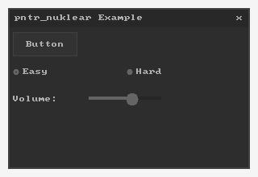

# pntr_nuklear

[Nuklear](https://github.com/Immediate-Mode-UI/Nuklear) immediate-mode graphical user interface for [pntr](https://github.com/robloach/pntr).



## Usage

``` c
#define PNTR_NUKLEAR_IMPLEMENTATION
#include "pntr_nuklear.h"

int main() {
    // Initialize
    pntr_font* font = pntr_load_font_default();
    struct nk_context* ctx = pntr_load_nuklear(font);

    // Nuklear GUI Code
    if (nk_begin(ctx, "Hello World", nk_rect(50, 50, 200, 150),
                    NK_WINDOW_BORDER|NK_WINDOW_MOVABLE|NK_WINDOW_CLOSABLE)) {
        nk_layout_row_dynamic(ctx, 0, 1);
        if (nk_button_label(ctx, "Button")) {
            printf("Hello World!\n");
        }
    }
    nk_end(ctx);

    // Render
    pntr_draw_nuklear(screen, ctx);

    // Unload
    pntr_unload_nuklear(ctx);
    pntr_unload_font(font);

    return 0;
}
```

### API

``` c
// Context
struct nk_context* pntr_load_nuklear(pntr_font* font);
void pntr_unload_nuklear(struct nk_context* ctx);
void pntr_nuklear_update(struct nk_context* ctx, pntr_app* app);
void pntr_draw_nuklear(pntr_image* dst, struct nk_context* ctx);

// Drawing
struct nk_image pntr_image_nk(pntr_image* image);
void pntr_nuklear_draw_polygon_fill(pntr_image* dst, const struct nk_vec2i* pnts, int count, pntr_color col);

// Conversion
struct nk_rect pntr_rectangle_to_nk_rect(pntr_rectangle rectangle);
pntr_color pntr_nk_color_to_color(struct nk_color color);
struct nk_color pntr_color_to_nk_color(pntr_color color);
pntr_color pntr_nk_colorf_to_color(struct nk_colorf color);
struct nk_colorf pntr_color_to_nk_colorf(pntr_color color);
pntr_vector pntr_nk_vec2i_to_vector(struct nk_vec2i vector);
```

### Images

Use `pntr_image_nk()` to hand a `pntr_image` to Nuklear:

``` c
nk_image(ctx, pntr_image_nk(app->image));
```

Nuklear's own `nk_image_ptr()` works too, and draws the whole image:

``` c
nk_image(ctx, nk_image_ptr(app->image));
```

### Nuklear

Nuklear is vendored at [`include/nuklear.h`](include/nuklear.h), and that copy is
the one that gets compiled. `pntr_nuklear.h` includes it with quotes, so it
resolves to the sibling file rather than anything on the include path.

To build against your own copy instead, point `PNTR_NUKLEAR_NUKLEAR_H` at it
before including `pntr_nuklear.h`:

``` c
#define PNTR_NUKLEAR_NUKLEAR_H "../vendor/nuklear/nuklear.h"

#define PNTR_NUKLEAR_IMPLEMENTATION
#include "pntr_nuklear.h"
```

`#define PNTR_NUKLEAR_NUKLEAR_H <nuklear.h>` works too, but only when your own
include directory comes before this one on the include path, since `include/`
holds a `nuklear.h` of its own. A path leaves no room for doubt.

## License

Unless stated otherwise, all works are:

- Copyright (c) 2023 [Rob Loach](https://robloach.net)

... and licensed under:

- [zlib License](LICENSE)
