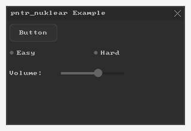

# pntr_nuklear

[Nuklear](https://github.com/Immediate-Mode-UI/Nuklear) immediate-mode graphical user interface for [pntr](https://github.com/robloach/pntr).



## Usage

With [pntr_app](https://github.com/robloach/pntr_app), call `pntr_nuklear_update()` to pass input to Nuklear, build the GUI, then draw it with `pntr_draw_nuklear()` every frame. Include `pntr_app.h` before `pntr_nuklear.h`, so that the input handling is compiled in.

``` c
#define PNTR_APP_IMPLEMENTATION
#define PNTR_ENABLE_DEFAULT_FONT
#include "pntr_app.h"

#define PNTR_NUKLEAR_IMPLEMENTATION
#include "pntr_nuklear.h"

static pntr_font* font;
static struct nk_context* ctx;

bool Init(pntr_app* app) {
    font = pntr_load_font_default();
    ctx = pntr_load_nuklear(font);
    return ctx != NULL;
}

bool Update(pntr_app* app, pntr_image* screen) {
    // Input
    pntr_nuklear_update(ctx, app);

    // Nuklear GUI Code
    if (nk_begin(ctx, "Hello World", nk_rect(50, 50, 200, 150),
                    NK_WINDOW_BORDER|NK_WINDOW_MOVABLE|NK_WINDOW_CLOSABLE)) {
        nk_layout_row_dynamic(ctx, 0, 1);
        if (nk_button_label(ctx, "Button")) {
            pntr_app_log(PNTR_APP_LOG_INFO, "Hello World!");
        }
    }
    nk_end(ctx);

    // Render
    pntr_clear_background(screen, PNTR_BLACK);
    pntr_draw_nuklear(screen, ctx);

    return true;
}

void Close(pntr_app* app) {
    pntr_unload_nuklear(ctx);
    pntr_unload_font(font);
}

pntr_app Main(int argc, char* argv[]) {
    return (pntr_app) {
        .width = 640,
        .height = 480,
        .title = "pntr_nuklear",
        .init = Init,
        .update = Update,
        .close = Close,
        .fps = 60,
    };
}
```

Without pntr_app, `pntr_nuklear_update()` does nothing, so feed input to Nuklear yourself between `nk_input_begin()` and `nk_input_end()` before building the GUI. `pntr_draw_nuklear()` calls `nk_input_begin()` for the next frame once it has drawn.

### API

``` c
// Context
struct nk_context* pntr_load_nuklear(pntr_font* font);
void pntr_unload_nuklear(struct nk_context* ctx);
void pntr_nuklear_update(struct nk_context* ctx, pntr_app* app);
void pntr_draw_nuklear(pntr_image* dst, struct nk_context* ctx);

// Drawing
struct nk_image pntr_image_nk(pntr_image* image);
void pntr_nuklear_draw_polygon_fill(pntr_image* dst, const struct nk_vec2i* pnts, int count, pntr_color col);

// Conversion
struct nk_rect pntr_rectangle_to_nk_rect(pntr_rectangle rectangle);
pntr_color pntr_nk_color_to_color(struct nk_color color);
struct nk_color pntr_color_to_nk_color(pntr_color color);
pntr_color pntr_nk_colorf_to_color(struct nk_colorf color);
struct nk_colorf pntr_color_to_nk_colorf(pntr_color color);
pntr_vector pntr_nk_vec2i_to_vector(struct nk_vec2i vector);
```

### Configuration

Define these before including `pntr_nuklear.h` to change how it behaves:

| Define | Default | Description |
| --- | --- | --- |
| `PNTR_NUKLEAR_NUKLEAR_H` | `"nuklear.h"` | Path to the Nuklear header to use. See [Nuklear](#nuklear). |
| `PNTR_NUKLEAR_API` | `PNTR_API` | Prefix for the public function declarations. |
| `PNTR_NUKLEAR_KEY_CHAR(app, key, shift)` | US QWERTY | Turns a pressed key into the character typed into text fields. Override it to support other keyboard layouts. Returns `0` for keys that don't type anything. |
| `PNTR_NUKLEAR_DOUBLE_CLICK_TIME` | `0.3f` | Seconds between two left clicks for them to count as a double click. |
| `PNTR_NUKLEAR_MAX_POLYGON_POINTS` | `64` | Most points drawn for a filled polygon. Debug builds assert when a polygon has more. |
| `PNTR_NUKLEAR_CURVE_SEGMENTS` | `22` | Line segments used to draw each curve. |
| `PNTR_NUKLEAR_DRAW_TEXT_BACKGROUND` | Not defined | Fill the background behind text. Nuklear draws widget backgrounds itself, so this is off by default. |

`pntr_nuklear.h` also sets up Nuklear with the following, unless they're already defined: `NK_INCLUDE_STANDARD_VARARGS`, `NK_INCLUDE_FIXED_TYPES`, `NK_INCLUDE_COMMAND_USERDATA`, `NK_INCLUDE_STANDARD_BOOL`, `NK_BUTTON_TRIGGER_ON_RELEASE`, and `NK_MEMSET`, `NK_MEMCPY`, `NK_SIN`, `NK_COS` and `NK_SQRT` mapped to pntr's. When pntr_app is included, `NK_KEYSTATE_BASED_INPUT` is defined too.

### Images

Use `pntr_image_nk()` to hand a `pntr_image` to Nuklear:

``` c
nk_image(ctx, pntr_image_nk(app->image));
```

Nuklear's own `nk_image_ptr()` works too, and draws the whole image:

``` c
nk_image(ctx, nk_image_ptr(app->image));
```

### Nuklear

Nuklear is vendored at [`include/nuklear.h`](include/nuklear.h), and that copy is
the one that gets compiled. `pntr_nuklear.h` includes it with quotes, so it
resolves to the sibling file rather than anything on the include path.

To build against your own copy instead, point `PNTR_NUKLEAR_NUKLEAR_H` at it
before including `pntr_nuklear.h`:

``` c
#define PNTR_NUKLEAR_NUKLEAR_H "../vendor/nuklear/nuklear.h"

#define PNTR_NUKLEAR_IMPLEMENTATION
#include "pntr_nuklear.h"
```

`#define PNTR_NUKLEAR_NUKLEAR_H <nuklear.h>` works too, but only when your own
include directory comes before this one on the include path, since `include/`
holds a `nuklear.h` of its own. A path leaves no room for doubt.

## License

Unless stated otherwise, all works are:

- Copyright (c) 2023 [Rob Loach](https://robloach.net)

... and licensed under:

- [zlib License](LICENSE)
